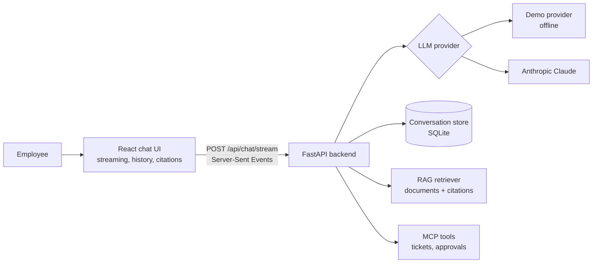

# Enterprise Chat Assistant


A full-stack AI chat assistant for the workplace. Employees ask questions in a React chat window and see answers stream in word by word, like ChatGPT or Claude. The assistant remembers the conversation, answers from company documents **with citations**, and can **take actions** such as raising an IT ticket or submitting a leave request through MCP tools.

It runs fully offline in demo mode (no API key needed). Set one environment variable to switch to Anthropic Claude.

## Build progress

This project is being built in milestones. Each one is a working, tested increment.

| # | Milestone | Status |
| --- | --- | --- |
| 1 | Backend chat API with Server-Sent Events streaming, demo and Claude providers | ✅ Done |
| 2 | React chat UI: streaming messages, markdown, stop button, light/dark theme | ⏳ Planned |
| 3 | Conversation memory: saved conversations, sidebar history, rename and delete | ⏳ Planned |
| 4 | Knowledge answers: RAG over company documents with clickable citations | ⏳ Planned |
| 5 | Actions: MCP tools for tickets and approvals, shown as cards in the chat | ⏳ Planned |
| 6 | Polish: Docker Compose, screenshots, end-to-end tests | ⏳ Planned |

## Architecture



| Layer | Responsibility |
| --- | --- |
| **React UI** (`frontend/`) | Chat window, streams tokens as they arrive, shows sources and action results |
| **FastAPI** (`backend/app/main.py`) | `/api/chat` (full reply) and `/api/chat/stream` (SSE); validation, history window, error events |
| **Providers** (`backend/app/providers.py`) | One `stream(messages, system)` interface for the offline demo and Claude; easy to add more |
| **Memory**, **RAG**, **tools** | Added in milestones 3 to 5, reusing ideas from [rag-knowledge-assistant](https://github.com/koorasupriya/rag-knowledge-assistant) and [mcp-agent-orchestrator](https://github.com/koorasupriya/mcp-agent-orchestrator) |

## Streaming protocol

`POST /api/chat/stream` returns `text/event-stream`. Each event is one JSON line:

```text
data: {"type": "start", "conversation_id": "c-1"}
data: {"type": "token", "content": "Hello! "}
data: {"type": "token", "content": "I'm "}
...
data: {"type": "done", "conversation_id": "c-1"}
```

If the model fails mid-answer, the stream ends with `{"type": "error", "message": "..."}` instead of just closing, so the UI can show a retry option.

## Quick start

### Backend

```bash
git clone https://github.com/koorasupriya/enterprise-chat-assistant.git
cd enterprise-chat-assistant/backend
python -m venv .venv && source .venv/bin/activate     # Windows: .venv\Scripts\activate
pip install -e ".[dev]"
uvicorn app.main:app --reload --port 8000
```

Try it:

```bash
curl -N -X POST localhost:8000/api/chat/stream \
  -H "Content-Type: application/json" \
  -d '{"messages": [{"role": "user", "content": "hello"}]}'
```

Interactive API docs are at http://localhost:8000/docs.

### Use Claude instead of demo mode

```bash
pip install -e ".[claude]"
export CHAT_PROVIDER=claude
export ANTHROPIC_API_KEY=your-key
```

### Frontend

Coming in milestone 2 (`frontend/`, React + Vite).

## Configuration

| Variable | Default | Purpose |
| --- | --- | --- |
| `CHAT_PROVIDER` | `demo` | `demo` (offline) or `claude` |
| `CHAT_MODEL` | `claude-sonnet-5-5` | Claude model when the provider is `claude` |
| `CHAT_SYSTEM_PROMPT` | Enterprise assistant prompt | Behaviour and tone of the assistant |
| `CHAT_MAX_TOKENS` | `1024` | Maximum length of each reply |
| `CHAT_MAX_HISTORY` | `20` | Number of recent messages sent to the model |
| `CHAT_CORS_ORIGINS` | `http://localhost:5173` | Allowed frontend origins (comma-separated) |

## Tests

```bash
cd backend && pytest
```

Backend tests cover the health check, full replies, the SSE event sequence, error events when the model fails mid-stream, request validation, the history window and provider selection.

## License

MIT
